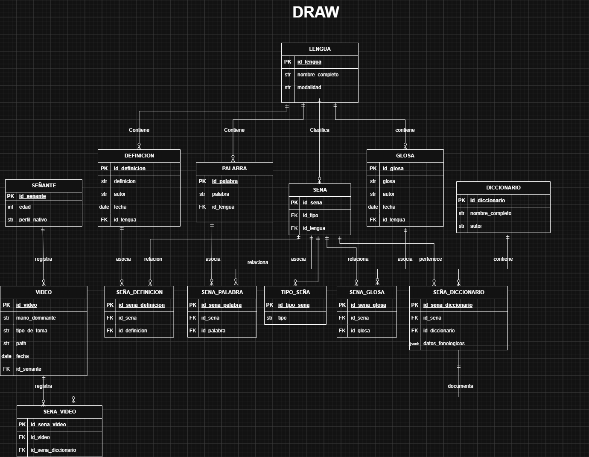

# LSM_DB
Base de Datos de Diccionarios de Lengua de Seña

Réplica en PostgreSQL del Diagrama Entidad-Relación del proyecto, cargada con el
Diccionario de Lengua de Señas Mexicana de la Ciudad de México (2017).



## Estructura

| Archivo | Contenido |
|---|---|
| `sql/01_schema.sql` | Crea el esquema `lsm`: 14 tablas, llaves, índices y validación del JSON |
| `sql/02_datos_dlsm_cdmx.sql` | Diccionario LSM CDMX 2017 (1,006 señas). **Generado**, no editar a mano |
| `sql/02b_glosas_dlsm_cdmx.sql` | Una glosa por seña (1,006), construida del significado. **Generado** |
| `sql/03_consultas.sql` | Catálogo completo de consultas (A1…K6), con glosas |
| `sql/04_consultas_relevantes.sql` | 20 consultas interesantes para explorar el diccionario |
| `sql/05_consultas_limitaciones.sql` | 13 límites del diseño de la base (independientes del diccionario), con demostración |
| `sql/06_consultas_api.sql` | Funciones `api.*` que devuelven JSON, como endpoints de una API |
| `sql/07_limitaciones_revisadas.sql` | Las 6 limitaciones de la presentación, revisadas con consultas |
| `sql/migraciones/` | Cambios para bases creadas antes (p. ej. quitar `sena_diccionario.id_lengua`) |
| `docs/SALIDAS.md` | Resultados de cada consulta. **Generado** por `scripts/generar_salidas.py` |
| `data/LSM_diccionario_Scraper.xlsx` | Scrapeo original del diccionario |
| `scripts/importar_dlsm_cdmx.py` | Convierte el Excel en `02_datos_dlsm_cdmx.sql` |
| `scripts/generar_glosas_dlsm_cdmx.py` | Construye las glosas y escribe `02b_glosas_dlsm_cdmx.sql` |
| `scripts/generar_salidas.py` | Ejecuta las consultas y escribe `docs/SALIDAS.md` |
| `schemas/datos_fonologicos.schema.json` | JSON Schema de `datos_fonologicos` |
| `docs/DATOS_FONOLOGICOS.md` | Campos del JSON, cuáles son obligatorios y ejemplos |
| `docs/IMPORTACION_DLSM_CDMX.md` | Qué se importó, correcciones aplicadas y pendientes |
| `docs/CONSULTAS.md` | Limitaciones del esquema y explicación de cada consulta |
| `docs/ESQUEMA_EXPLICADO.md` | Cada tabla explicada en texto, con el campo `nota` para excepciones |
| `docs/LIMITACIONES_REVISADAS.md` | Las 6 limitaciones: cuáles siguen y cuáles ya no, con resultados |
| `docs/DECISIONES_DE_DISENO.md` | Por qué partimos del esquema y no del diccionario, lengua única, ABANDONAR |
| `docs/TRABAJO_FUTURO.md` | Verbos, señas compuestas y metadata discretizada |
| `docs/EJERCICIOS_ANOTACION_MANUAL.md` | Ejercicios para resolver consultas a mano, con soluciones |
| `docs/BITACORA.md` | Registro de discusiones y decisiones abiertas (mesa redonda pendiente) |
| `docs/img/diagrama_er.png` | Diagrama entidad-relación actualizado |

## Instalación

```bash
createdb lsm_db
psql -d lsm_db -f sql/01_schema.sql -f sql/02_datos_dlsm_cdmx.sql -f sql/02b_glosas_dlsm_cdmx.sql
```

Para ver los resultados de las consultas:

```bash
python3 scripts/generar_salidas.py          # todas -> docs/SALIDAS.md
python3 scripts/generar_salidas.py A1 D7    # solo esas, en pantalla
```

`01_schema.sql` borra y vuelve a crear el esquema `lsm`, así que se puede ejecutar varias veces para reiniciar la base.

Para regenerar el SQL del diccionario después de cambiar el Excel o el script:

```bash
pip install openpyxl
python3 scripts/importar_dlsm_cdmx.py
```

## Tablas

- **Catálogos:** `lengua`, `diccionario`, `senante`, `tipo_sena` (un tipo por seña)
- **Contenido por lengua:** `palabra`, `glosa`, `definicion`, `sena`
- **Grabaciones:** `video`
- **Tablas intermedias:** `sena_palabra`, `sena_glosa`, `sena_definicion`, `sena_diccionario` (con `datos_fonologicos` JSONB validado), `sena_video`

## Diferencias con el diagrama

1. **Nombres sin Ñ:** `SEÑA` → `sena`, `SEÑANTE` → `senante`, etc.
2. **`lengua.nombre_completo`** aparece como `int`; se usa `VARCHAR` porque guarda un nombre.
3. **`palabra.id_lengua`** no está marcado como FK en el diagrama, pero la relación "Contiene" lo une con `lengua`; se declara FK.
4. **`tipo_sena`** es un catálogo (`id_tipo_sena`, `tipo`) y `sena.id_tipo` es FK hacia él (corregido en el diagrama).
5. **`sena_video.id_sena_video`** aparece como FK pero subrayado; se implementa como PK.
6. **`sena_diccionario` ya no tiene `id_lengua`** (ni la relación «identifica»): la lengua de una entrada es la de su seña. Ver `docs/DECISIONES_DE_DISENO.md`.
7. Se agregaron restricciones `UNIQUE` en las tablas intermedias, índices sobre las FK, un índice GIN sobre `datos_fonologicos` y la validación del JSON (`docs/DATOS_FONOLOGICOS.md`).
